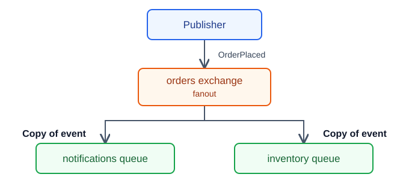

# RabbitMQ workshop — first practical exercise

Start small: use RabbitMQ's browser dashboard to route an `OrderPlaced` event to two independent services. Allow **15–20 minutes**. Docker Desktop is the only software dependency; no application runtime is needed.

## 1. Start RabbitMQ

Start Docker Desktop and wait until its engine is running. On Windows, use Linux containers. Open a terminal in this repository and run:

```powershell
docker compose up -d --wait
docker compose ps
```

The first run downloads the image and can take a few minutes. The RabbitMQ service should show `healthy`.

Open <http://localhost:15672> and log in with username **workshop** and password **workshop**. These are local workshop credentials. Ports bind to localhost only.

- `15672`: browser dashboard and management HTTP API.
- `5672`: AMQP connections for application code in a later exercise.

The broker uses a named volume so its data survives container recreation.

## 2. Exercise: one order, two subscribers

**Scenario:** an online shop publishes an order event. A notification service and an inventory service each need their own copy.



### A. Build the route 

1. Open **Exchanges**, expand **Add a new exchange**, and create `orders` with type **fanout** and **Durable** enabled. Leave other settings at their defaults.
2. Open **Queues and Streams**, expand **Add a new queue**, and create a **Classic**, **Durable** queue named `notifications` in virtual host `/`. Repeat for `inventory`.
3. Open the `orders` exchange. Under **Bindings**, add a binding **To queue** with destination `notifications`. Leave the routing key empty. Repeat for `inventory`.

**Predict first:** if you publish one event, how many messages will each queue receive?

### B. Publish an order

On the `orders` exchange page, expand **Publish message**. Leave the routing key empty. Add the property `delivery_mode` with numeric value `2`,. Paste this payload and publish once:

```json
{
  "eventType": "OrderPlaced",
  "orderId": "ORD-001",
  "product": "Workshop mug",
  "quantity": 2
}
```

Go to **Queues and Streams**. After the dashboard refreshes, each queue should show **Ready: 1** and **Consumers: 0**. The event is waiting even though no application services are running.

### C. Act as the two consumers 

1. Open `notifications`, expand **Get messages**, request **1** message, select **Ack mode: Automatic ack**, and click **Get Message(s)**. Read the payload and pretend to send an order confirmation.
2. Refresh the queue overview. `notifications` should now have **Ready: 0**; `inventory` should still have **Ready: 1**.
3. Get and automatically acknowledge the message from `inventory`. Pretend to reduce stock by two mugs. Both queues should now be empty.

The dashboard's Get messages operation is a manual inspection tool used here to simulate a consumer. A real application normally subscribes over AMQP and acknowledges after successful processing. Automatic acknowledgement in this exercise removes the message without checking your simulated business action.

### Questions after exercise:

- Why did consuming from `notifications` leave the inventory message available?
- What happens if the inventory service is offline when an order is published?
- Would two consumers sharing one queue each receive a copy of every event?

**Success:** publish once, observe one message per queue, then empty each queue independently. Repeat with `ORD-002` if you want to rehearse.

**Optional experiment:** publish another event, get it with **Nack message requeue true**, and check that it remains available. Then get it using **Automatic ack** to remove it.

## 3. Stop and restart

```powershell
docker compose stop
docker compose start
```

To remove containers while keeping broker data:

```powershell
docker compose down
```

For a clean workshop reset, the following command **deletes this Compose project's RabbitMQ volume, including its queues and messages**. Recreate the exercise topology afterward:

```powershell
docker compose down -v
docker compose up -d --wait
```

## Instructor notes

One queue per service gives each service its own copy; multiple consumers on a single queue compete for messages. This exercise demonstrates routing and buffering, not complete delivery guarantees. Durable queues and persistent messages are useful, but a later coded exercise should cover manual acknowledgements, publisher confirms and idempotent processing. RabbitMQ does not make business processing exactly once automatically.

Next small step: add one containerized consumer that reads `notifications` and acknowledges after logging an order confirmation.

## Sources

- [RabbitMQ Docker setup](https://www.rabbitmq.com/docs/4.3/download).
- [Management dashboard](https://www.rabbitmq.com/docs/management).
- [Publish/subscribe tutorial](https://www.rabbitmq.com/tutorials/tutorial-three-javascript) — fanout exchanges and separate queues.
- [Consumer acknowledgements and publisher confirms](https://www.rabbitmq.com/docs/confirms).
